# ETHZ - Lausanne Cathedral Slideshow

## The Project

This project is a slideshow application for ETHZ, showcasing various aspects of cathedral architecture and related topics.

The specific technologies used in this project are:

- [TypeScript](https://www.typescriptlang.org/): A popular programming language that compiles to plain JavaScript which can be understood by browsers.
- [React.js](https://react.dev/): A JavaScript library for building user interfaces.
- [Next.js](https://nextjs.org/): A React.js framework that implements common necessities like routing, image-optimisation and compiling the application into static files.

## How to's

### Getting set up for development with Github codespaces

The easiest way to get started without having to install anything is to use [Github Codespaces](https://docs.github.com/en/codespaces), which will set up a development environment online and give you a professional code-editor right in the browser.

To start, create a new [branch](https://docs.github.com/en/pull-requests/collaborating-with-pull-requests/proposing-changes-to-your-work-with-pull-requests/about-branches) to work on. This lets you test and validate your changes before merging them into the `main` branch from where they are compiled and deployed. This is good practice to avoid breaking `main` with unfinished code.

Click on the branch selector in the top left corner and type the name of your new branch. If that branch doesn't exist yet, it will give you the option to create it:

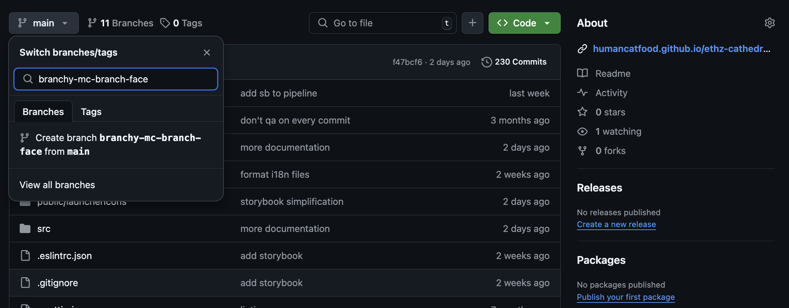

Once you have the desired branch created and selected, expand the green "<> Code" button and click "Create codespace on <your branch's name>" (if you have a codespace already, it will be available in a list):

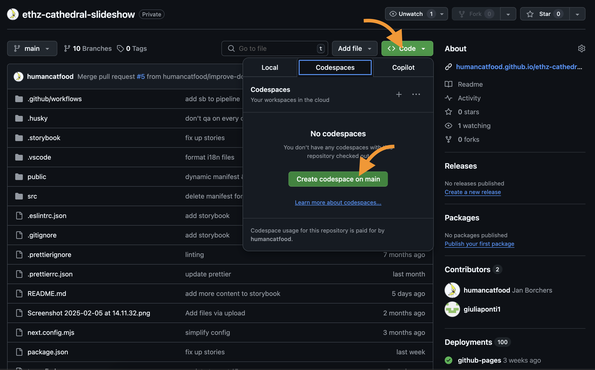

You will then be redirected to the codespace editor, a fully functional IDE (integrated development environment) running in the browser:

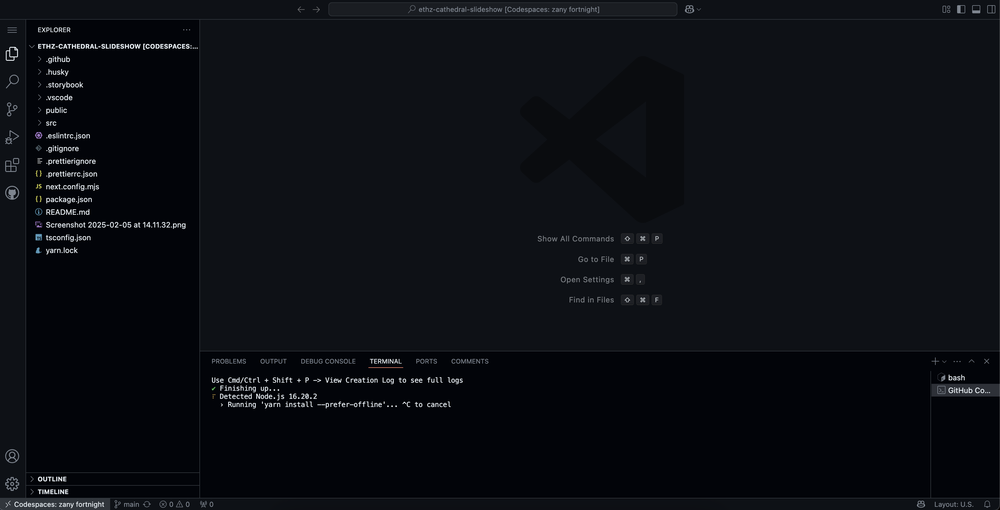

The highlighted area is the `Terminal` panel where you can run commands. After the startup stuff is done, enter

`yarn`

which will install all the dependencies needed to run the application, and then

`yarn dev`

which will start the development server:

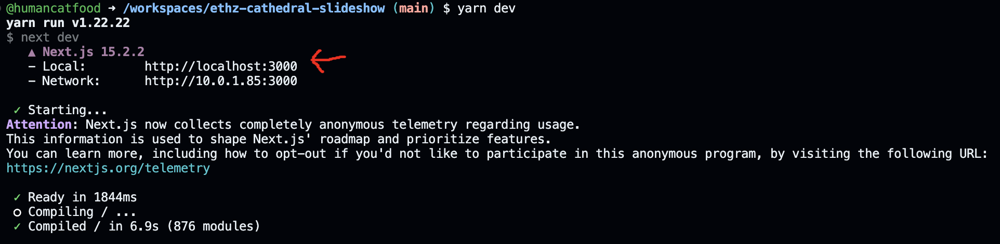

Finally, hold down the `cmd` or `ctrl` key and click on the line reading

`http://localhost:3000`

which will open a new tab with the application running in it.

#### Making changes and publishing them

You can now edit code in the `src` directory. The application will automatically reload as you save your changes.

To [`commit`](https://docs.github.com/en/pull-requests/committing-changes-to-your-project/creating-and-editing-commits/about-commits) your changes, open the `Source Control` panel on the left:

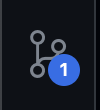

Here you find all the changes you made to the code. _Stage_ the changes you want to commit by clicking the `+` icon next to the file name:

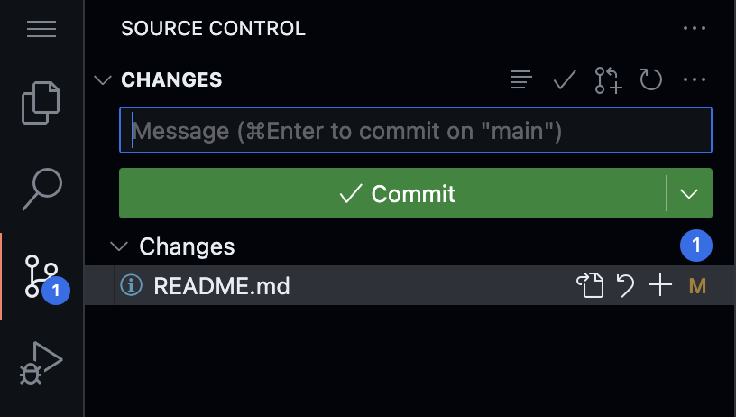

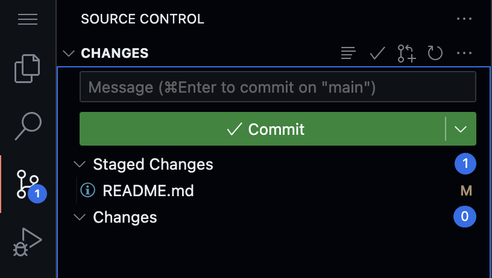

Finally, write a quick message describing the changes you made and click "Commit" to save them to your branch.

‼️ Watch out for the "Discard Changes" button. This will delete all uncommited the changes and cannot be undone ‼️

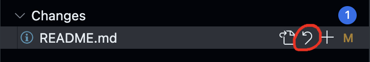

Once you're happy with your branch, click "Publish Branch" to make it available in the Github repository (so far they only exist in the _WorkSpace_):

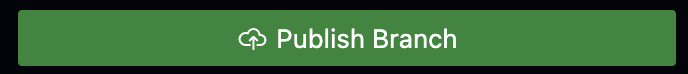

(If you've already published it, the button will say "Sync Changes")

‼️ Codespaces get deleted after a couple of weeks of inactivity, so make sure to commit and push/sync changes regularly ‼️

---

Now you can create a [Pull Request](https://docs.github.com/en/pull-requests) to merge your changes into the `main` branch so they get published.

Back in Github, click on the "Pull Requests" tab. There you should see your recently changed branch with an option to "Compare & pull request". You can also click on "New Pull Request", which will take you to a page where you can select the branch you want to merge.

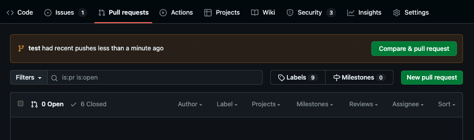

Follow the instructions to create a pull request. You can add a title and description to explain what changes you made and why.

Once you're done, click "Create pull request". This will run some automated checks, (for example that the translation files have matching structures and are referenced correctly), and give collaborators the chance to review and discuss your changes through comments.

Finally, click "Merge pull request":

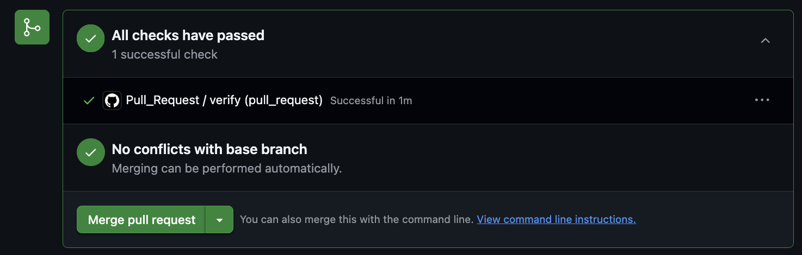

Merging a branch into `main`, or pushing changes directly to `main` will trigger a new build of the application, signified by an orange dot on the repositories main page:

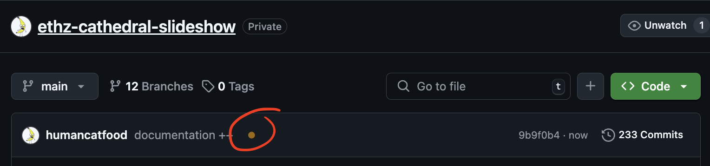

Once the dot turns into a green tick, the build is finished and the changes are live and available at

https://humancatfood.github.io/ethz-cathedral-slideshow/

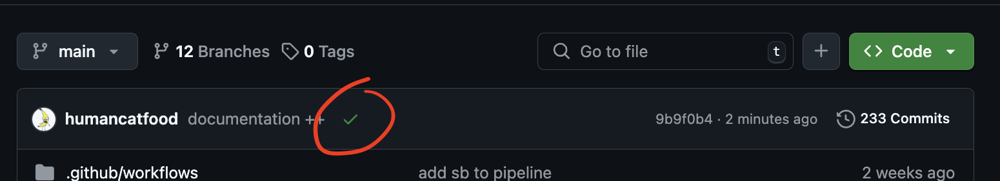

---

### Adding a new page

Create a new directory inside `src/app/[locale]` and add a file named `page.tsx` (The easiest way to get started is to copy an existing `page.tsx` file and modify it to your liking).

The file's location will determine the `URL`, or address of the page. For example, if you create the page as `src/app/[locale]/new-page/page.tsx`, the page will be accessible at `/en/new-page`. You need this later to link to it from another page or the navigation menu.

ℹ️ The `[locale]` part of the url is a placeholer (a so-called _dynamic segment_)which will be replaced by the actual locale (e.g. `en`, `fr`, etc.) when the app is running. This allows you to create pages that are available in multiple languages without having to duplicate the code for each language. ℹ️

Here is an example `page.tsx` file with a breakdown of what the code does:

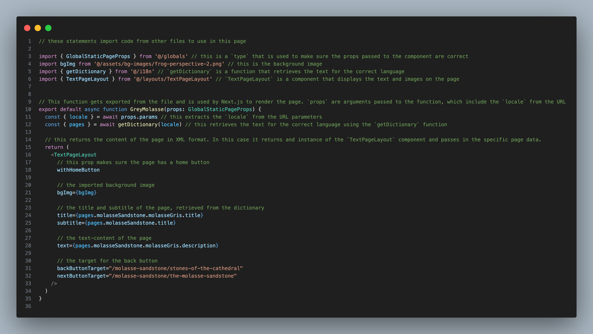

The `layouts` are reusable components that define the structure and style of the page. Demos of the available layouts and their capabilities can be found here:

https://humancatfood.github.io/ethz-cathedral-slideshow/components

---

### Adding a page to the navigation menu

To add your new page it to the navigation menu, open the file `src/navigation.ts` and place a new entry to the list returned by the `getNavMenu` function:

```tsx
export function getNavMenu({ pages }: Dictionary): NavMenuItem[] {
  return [
    ...other entries,
    {
      label: pages.myNewPage.title,
      path: '/new-page',
    }
  ]
}
```

You can also nest pages under other pages by adding them to the `subItems` field:

```tsx
export function getNavMenu({ pages }: Dictionary): NavMenuItem[] {
  return [
    {
      label: pages.somePage.title,
      path: '/some-page',
      subItems: [
        {
          label: pages.someOtherPage.title,
          path: '/some-other-page',
          subItems: [
            {
              label: pages.myNewPage.title,
              path: '/new-page',
            },
          ],
        },
      ],
    },
  ]
}
```

---

### How to change or add text

The text content of the application can be found in the `*.json` files under `./src/i18n` (e.g. `en.json` for English).

ℹ️ [JSON](https://www.json.org/json-en.html) is a popular file format for expressing structured data in key/value pairs. ℹ️

The nesting of the file determines the `path` at which the text is available in the `dictionary` that gets passed into the `makePage` and `getNavMenu` functions. Consider for example this `en.json` file:

```json
{
  "pages": {
    "start": {
      "title": ["The Cathedral", "of Lausanne"],
      "subtitle": "Center for Digital Information",
      "actions": {
        "website": "Cathedral Web Site",
        "birthday": "750th Birthday",
        "immersive": "The Immersive Cathedral"
      }
    }
  }
}
```

The label "Cathedral Web Site" can be accessed in the `page.tsx` file like so:

```tsx
export default makePage((dictionary) => {
  return (
    <TitlePageLayout
      title={dictionary.pages.start.title}
      subtitle={dictionary.pages.start.subtitle}
      links={[
        {
          label: dictionary.pages.start.actions.immersive,
          target: '/the-immersive-cathedral',
        },
      ]}
    />
  )
})
```

‼️ Make sure that all language files have the same key-structure. If a key is missing or spelled inconsistently, you will see an error in the code:

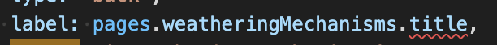

‼️

## TODOs:

- [ ] setup PWA caching
- [ ] make centered quiz layout and change Oldest Stone Game to use it
- [ ] make dynamic titles
